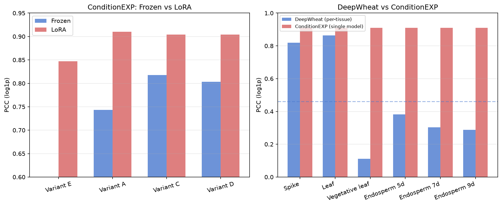
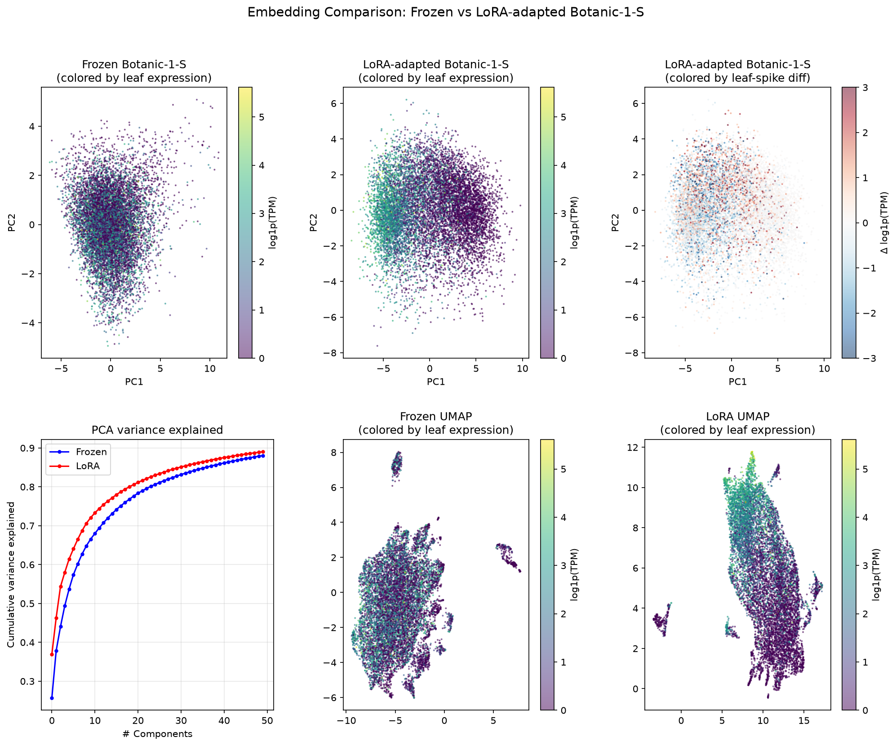

# PLANTED
### **PL**ant foundation model **A**dapted **N**etwork for **T**issue **E**xpression pre**D**iction

Multi-tissue gene expression prediction in wheat using LoRA-adapted genomic foundation model embeddings.

[Contact the author](mailto:michael.banf@gmx.net) for help or questions.

## About

Predicting gene expression across tissues and developmental stages is central to understanding gene regulation in crops. Existing approaches such as DeepWheat train separate convolutional models per tissue, limiting cross-tissue knowledge sharing and scalability.

**PLANTED** is a lightweight, unified multi-tissue gene expression predictor for wheat (*Triticum aestivum*) that combines:
- **LoRA-adapted embeddings** from the 318M-parameter [Botanic-1-S](https://huggingface.co/InstaDeepAI/botanic-1-S) BiMamba2 foundation model (pretrained on 692 plant genomes)
- **Epigenomic features** (6 histone modification marks) via a convolutional encoder
- **FiLM conditioning** on tissue identity for multi-tissue prediction with a single model

Using only **1.0M trainable head parameters**, PLANTED achieves a Pearson correlation of **0.910** on log-transformed expression and **0.816** on TPM-scale expression across six wheat tissues — substantially outperforming DeepWheat (mean PCC = 0.461, 245M total parameters across six separate models).



## Key Results

| Model | Params | PCC (log) | PCC (TPM) | Tissues |
|-------|--------|-----------|-----------|---------|
| **PLANTED (Variant A)** | **1.0M** | **0.910** | **0.816** | **All 6 (single model)** |
| PLANTED (Variant C) | 10.6M | 0.904 | 0.810 | All 6 (single model) |
| PLANTED (epi-only) | 0.65M | 0.847 | 0.654 | All 6 (single model) |
| Frozen embeddings (best) | 10.6M | 0.818 | 0.401 | All 6 (single model) |
| DeepWheat (leaf) | 37.8M | 0.864 | — | Leaf only |
| DeepWheat (mean, 6 tissues) | 244.9M | 0.461 | — | 6 separate models |

### Highlights

- **LoRA adaptation is essential**: PCC improves from 0.744 (frozen) to 0.910 with only 13 MB of adapter weights (rank 16, 3 epochs)
- **Simpler is better with strong embeddings**: The 1.0M-param concat head outperforms the 10.6M-param cross-attention + FiLM head
- **Cross-tissue sharing matters**: DeepWheat achieves PCC = 0.864 on leaf but collapses on developmental tissues (e7: 0.303, vl: 0.111); PLANTED maintains 0.910 across all tissues
- **Sequence + epigenomics complement each other**: Adding foundation model embeddings to epigenomic features improves PCC by +0.063 (log) and +0.162 (TPM)



## Architecture

```
Gene locus                              Tissue identity
──────────                              ───────────────
┌────────────┐   ┌────────────┐         ┌──────────┐
│ TSS region │   │ TTS region │         │  Tissue  │
│  2000 bp   │   │   700 bp   │         │  token   │
└─────┬──────┘   └─────┬──────┘         └────┬─────┘
      │                │                     │
      ▼                ▼                     │
┌────────────────────────────────┐           │
│   Botanic-1-S (318M params)   │           │
│   BiMamba2 + LoRA (rank 16)   │           │
└─────┬────────────────┬────────┘           │
  mean-pool        mean-pool                │
  [1024-d]         [1024-d]                 │
      └──────┬─────────┘                    │
         [2048-dim]                         │
             │       ┌──────────────┐       │
             │       │ 6 Histone    │       │
             │       │ marks →      │       │
             │       │ Conv1D enc.  │       │
             │       └──────┬───────┘       │
             └──────┬───────┘               │
                concat                      │
                  │                         │
           ┌──────▼──────────┐              │
           │  MLP Head (1M)  │◄─────────────┘
           │  FiLM cond.     │  (γ·x + β per tissue)
           │  512 → 256 → 1 │
           └───────┬─────────┘
                   ▼
           predicted log₂(TPM+1)
           × 6 tissues
```

## Tissues

| Tissue | Description |
|--------|-------------|
| leaf | Mature leaf |
| spike | Spike/inflorescence |
| vl | Vegetative leaf |
| e5 | Endosperm 5 days post-anthesis |
| e7 | Endosperm 7 days post-anthesis |
| e9 | Endosperm 9 days post-anthesis |

## Installation

```bash
git clone https://github.com/mbanf/PLANTED.git
cd PLANTED
python -m venv .venv
source .venv/bin/activate
pip install -r requirements.txt
```

### Data Setup

```bash
# Download wheat genome data, epigenomic marks, and DeepWheat models
bash scripts/00_download_data.sh
```

## Usage

### 1. Precompute embeddings (requires GPU)

```bash
# Frozen Botanic-1-S embeddings
python scripts/01_precompute_embeddings.py --data-dir data --out data/embeddings

# LoRA fine-tuning (optional — pretrained adapter provided)
python scripts/01b_finetune_lora.py --data-dir data --out data/lora_adapted
```

### 2. Train expression prediction head

```bash
python scripts/02_train_conditionexp.py \
    --embeddings data/lora_adapted/all_botanic1s_lora.npz \
    --epi-dir data/zenodo/DeepExp/data \
    --tpm-dir data/zenodo/DeepExp/data \
    --variant A \
    --out results/
```

### 3. Evaluate DeepWheat baseline

```bash
python scripts/03_eval_deepwheat_baseline.py \
    --data-dir data/zenodo/DeepExp/data \
    --model-dir data/zenodo/DeepExp/model \
    --out results/deepwheat_baseline
```

### 4. Generate paper figures

```bash
python scripts/04_analyses.py --base-dir .
```

## Pretrained Weights

| Asset | Size | Description |
|-------|------|-------------|
| `lora_adapter/` | 13 MB | LoRA adapter weights (rank 16) for Botanic-1-S |
| `expression_head.pt` | 1.1 MB | Best prediction head (Variant A) |
| `all_botanic1s_lora.npz` | 851 MB | Precomputed LoRA-adapted embeddings (117,319 genes) |

## References

**PLANTED algorithm and results**

Banf M. PLANTED: multi-tissue gene expression prediction in wheat via foundation-model transfer learning. *Bioinformatics* (2026). (in preparation)

**Botanic-1-S foundation model**

InstaDeep. Botanic: Foundation Models for Plant Genomics. *bioRxiv* (2025).

**DeepWheat baseline**

Zanini SF, Bayer PE, et al. DeepWheat: A deep learning-based approach for accurate prediction of gene expression in wheat. *bioRxiv* (2024).

**LoRA**

Hu EJ, Shen Y, et al. LoRA: Low-Rank Adaptation of Large Language Models. *arXiv:2106.09685* (2022).

**FiLM conditioning**

Perez E, Strub F, et al. FiLM: Visual Reasoning with a General Conditioning Layer. *AAAI* (2018).

## License

MIT
